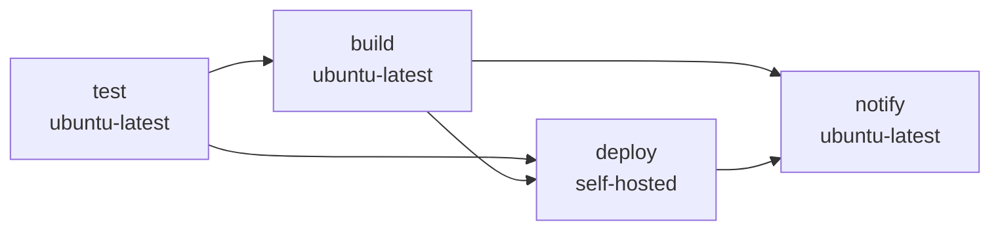

# x-herald CI 与发布约定

一条原则：**每个门都必须会失败，失败必须向上传播**。CI 的价值不在跑得多，而在出问题时一定红。

本文每条规则都对应可执行事实（`scripts/ci.sh`、`.vite-hooks/*`、`scripts/commit-msg.mjs`、`.github/workflows/docker-build.yml`、`Dockerfile`），并由 `scripts/ci-contract.test.ts` 断言。改 CI 时三者同步改：配置、测试、本文。

## 一、质量门：`scripts/ci.sh`

本地与 CI 复用同一脚本（`bun run ci`），杜绝"本地过、CI 挂"。`set -euo pipefail`，8 段串行：

| # | 阶段 | 命令 |
|---|---|---|
| 1 | format + lint + typecheck | `bun run check` |
| 2 | CI 脚本回归 | `bun test scripts/ci.test.ts` |
| 3 | CI 契约 | `bun test scripts/ci-contract.test.ts` |
| 4 | UI | `bun run test:ui` |
| 5 | ai-agent | `bun test` |
| 6 | agent-extensions | `bun test` |
| 7 | backend | `bun test --isolate` |
| 8 | CLI | `bun test src/`（apps/cli） |

### `--isolate` 是正确性要求，不是加速开关

`mock.module()` 注册在**进程全局**且"先注册者生效"，`mock.restore()` 不会撤销。任何把 `db/client` 换成残缺假对象的测试文件都会污染同 worker 后续所有文件，产生 `db.insert is not a function` 这类雪崩。文件执行顺序在 Linux runner 与 macOS 本地不同，所以这种污染**只在 CI 显形**。

`apps/gateway/package.json` 的 `test` 与 `ci.sh` 都必须带 `--isolate`，两点都有断言。

### 退出码 99：只在"确实 0 fail"时豁免

bun 在 `--isolate` teardown 时即使 0 失败也可能以 99 退出。豁免必须窄：

```bash
set +e
bun test --isolate --reporter=dots 2>&1 | tee "$LOG"
STATUS=${PIPESTATUS[0]}
set -e
if [ "$STATUS" -eq 99 ] && grep -qE '^[[:space:]]*0 fail[[:space:]]*$' "$LOG"; then
  STATUS=0
fi
exit "$STATUS"
```

- 取 `PIPESTATUS[0]`（bun 的码），不是 `tee` 的。
- **禁止无条件** `exit 0`：那会让真实回归以 99 静默通过。`scripts/ci.test.ts` 专门断言 backend 以 99 退出且汇总非 0 fail 时必须仍失败。

## 二、钩子：三段，职责不同

`.vite-hooks/` 经 `core.hooksPath .vite-hooks/_` 生效；`_/h` 是转发器，真实脚本在 `.vite-hooks/<name>`。

| 钩子 | 内容 | 为什么这样切 |
|---|---|---|
| `commit-msg` | `scripts/commit-msg.mjs` | 提交信息格式门 |
| `pre-commit` | `bunx lint-staged` | 只处理暂存文件，秒级反馈 |
| `pre-push` | `bun run check` + 路由测试子集 | 挡住类型/格式/核心回归；全量留给 CI |

- pre-commit 的 lint-staged 配置：ts/tsx/js/jsx → `oxlint --fix` + `oxfmt`；json/md/yml/yaml → `oxfmt`。
- pre-push 的子集：`route-rule-compiler`、`access-model-router`、`routing-trace-recorder`、`features/route-rules`。全量 1900+ 测试只在 CI 跑，否则每次 push 数分钟。
- pre-commit 用 shell 脚本而非 `package.json` script：`bun run` 会把退出码 99 当特殊信号，包一层才可控。

## 三、提交信息：机器校验

`scripts/commit-msg.mjs` 规则（门禁，非建议）：

- `<type>[(scope)]: <subject>`，`!` 标记破坏性变更
- 类型白名单：`feat fix docs style refactor perf test build ci chore revert`
- subject ≤ 72 字符、不以句号结尾、首字母小写
- 豁免 `Merge ` / `Revert ` 开头

scope 用受影响层，多个逗号分隔：`fix(gateway,web,ui): ...`。

## 四、流水线：四段式



- **test**：`setup-bun` → `bun install` → `./scripts/ci.sh` → 覆盖率 artifact（`if: always()`）→ Playwright → E2E → web build。**全程无 `continue-on-error`**。
- **build**：`needs: test`；QEMU + buildx 出 amd64/arm64；PR 只构建不推送。
- **deploy**：`needs: [test, build]`，self-hosted，PR 与 tag 不部署。
- **notify**：`needs: [build, deploy]`、`if: always()`，**跑托管 runner** —— 它是部署失败的告警通道；与 deploy 共用 self-hosted 会让 runner 一离线告警同时静默。

触发：`push` 到 `main|master|ci/**|feat/**|fix/**|refactor/**` 与 `v*` tag；`pull_request` 仅 `main|master`。

### 镜像 tag

| 场景 | tag |
|---|---|
| main / master | `latest` |
| 其他分支 | `alpha`（滚动覆盖） |
| `v*` tag | `{{version}}` / `{{major}}.{{minor}}` / `{{major}}` |
| PR | `pr-*` + `sha-*` |

不按分支名发 tag：镜像会无限堆积，部署侧也没有稳定引用名。

### 独立发布链：CLI 二进制（`cli-release.yml`）

CLI 不随镜像发布，触发条件与镜像刻意分开：`cli-v*` tag（版本须等于 `apps/cli/package.json`）→ 5 平台自包含二进制 + `SHA256SUMS`，挂在 GitHub Release 上。

不复用 `ci.sh`：CLI 是叶子包，若用网关全套测试卡住 CLI 发布，一次 CLI 修复会排在与它无关的失败后面。workflow 自己跑 `apps/cli` 的 typecheck 与测试（该测试也已是 `ci.sh` 第 8 段）。

两条断言防产物静默降级：

1. tag 版本必须等于 `apps/cli/package.json` 的 version，否则二进制 `--version` 与实际不符 —— 与镜像的版本断言同一类失效。
2. 构建后用产物自身验证技能已内嵌：`skill show commands.json | jq -e '.commands|length>90'`，再 `skill install --dir` 断言文件落盘。技能是静态导入，一旦不再内嵌，二进制会静默失去全部文档。

安装脚本 `scripts/install-cli.sh` 在缺少 `SHA256SUMS` 或校验不符时**必须失败**，不允许"下载即安装"。

## 五、部署：健康检查 + 版本断言

`docker pull` → `docker-compose up -d` 之后两道验证：

1. **存活 + 健康**：容器不得 `exited`/`dead`；用**容器内** `bun -e fetch('http://localhost:3000/api/health')` 轮询 30×5s。不能用宿主机 curl，端口映射不一致会误判。
2. **版本断言**：健康检查只看 200，无法区分"新版上线"与"旧容器还在跑"。必须比对容器内 `/api/health` 的 `commitHash` / `buildRef` 与本次 `GITHUB_SHA::7` / `GITHUB_REF_NAME`，不一致即失败。

版本要跨三跳不丢：workflow `build-args` → Dockerfile `ARG` → 运行时 `ENV`。任一跳改名（`GIT_HASH` vs `GIT_COMMIT_HASH`）都会静默取默认值，线上长期显示 `dev`/`unknown`。要求：

- 三个 ARG 声明在 `base` 阶段（builder 与 runner 都继承）
- 同步 `ENV X=${X}` 提升为运行时环境变量
- compose **不得**用 `${GIT_COMMIT_HASH:-unknown}` 覆盖镜像内烘焙值

三条都有断言。

### 部署侧高频失效点

- 服务器 compose 的 image 必须可插值：`image: ghcr.io/<org>/<repo>:${IMAGE_TAG:-latest}`。硬编码标签会"拉了 alpha 仍跑旧镜像"，且不报错。
- self-hosted job 设 `timeout-minutes`：兜住开始执行后挂死（排队时长不受其约束）。

## 六、用测试钉死 CI

`scripts/ci.test.ts` 与 `scripts/ci-contract.test.ts` 是元层。前者验证失败传播、99 不被吞、发布门顺序、版本三跳；后者验证本文描述的 8 段结构、无 `continue-on-error`、notify 不共用部署 runner、钩子分工、提交信息规则，并禁止本文出现已知的错误说法。

新增 CI 约束的正确顺序：**先写断言，再改配置，最后改本文**。

## 七、复刻检查单

1. `ci.sh`：8 段顺序 + `set -euo pipefail` + `PIPESTATUS` + 窄豁免 99
2. 后端测试含 `--isolate`（顺序无关性要求）
3. 钩子三段分工；pre-commit 只 lint-staged；pre-push 是 check + 核心子集
4. `commit-msg.mjs`：类型白名单 + 72 字符 + 小写 + 无末尾句号
5. workflow：test 无 `continue-on-error`；build/deploy `needs: test`；notify `always()` 且在托管 runner
6. Dockerfile：版本 ARG 在 base 阶段并提升为 ENV；runner 装 `ca-certificates`（否则容器内 HTTPS 全挂）
7. 部署：容器内健康检查 + 版本断言 + compose image 可插值
8. 为 1–7 写断言
